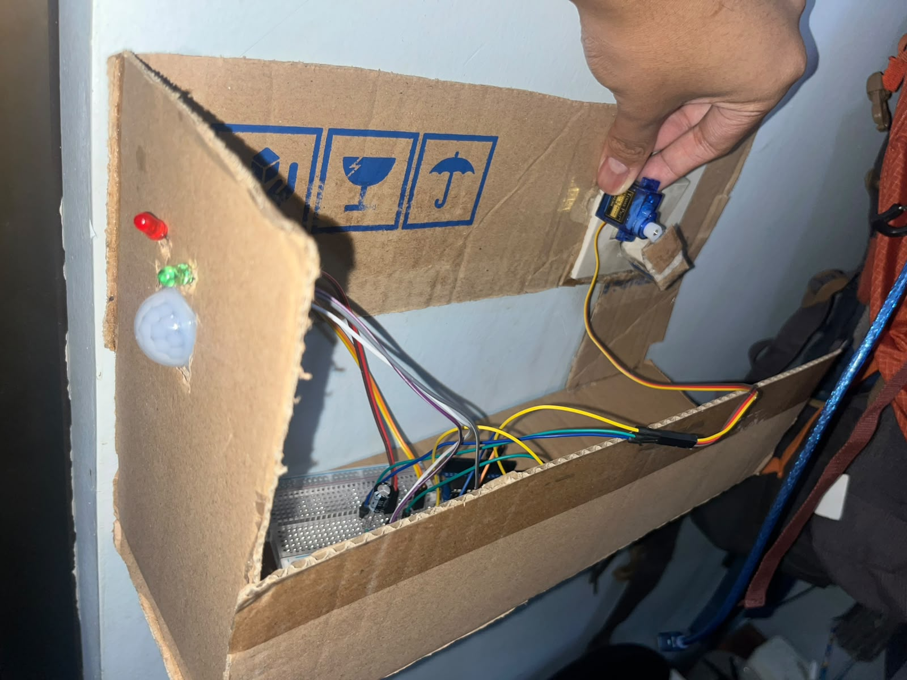
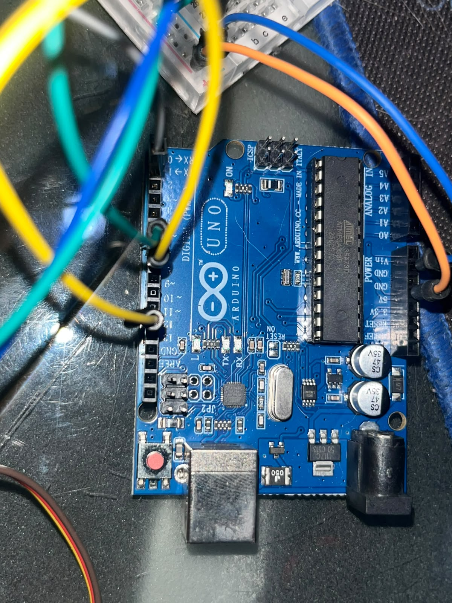

# Smart Motion-Activated Room Light System (Arduino)

## Overview
An ongoing hardware prototyping project integrating an Arduino Uno, an HC-SR501 PIR motion sensor, and an SG90 servo motor to explore automated room lighting control. Integrated a DIY mount onto the switch itself and a DIY extension for the servo arm.

## Visual Documentation & Prototyping
* **Circuit & Wiring:**
    
* **Circuit Wiring & Testing:**
  *(demo_video.mp4)*
  
## Components Used
| Component / Part Name | Quantity |
| :--- | :--- |
| Arduino Uno (ATmega328P) | 1 |
| HC-SR501 PIR Sensor | 1 |
| SG90 Micro Servo Motor | 1 |
| Portable USB Power Bank | 1 |
| Electrolytic Capacitor 100μF | 1 |
| Green LED | 1 |
| Red LED | 1 |
| 1K Resistor | 1 |
| 5.1k Resistor | 1 |
| Breadboard | 1 |
| Jumper Wires, Male-Male Wires, Male-Female Wires | - |

## Simple Circuit Guide & Wiring
* **Power Supply:**
  * Powered via a portable USB power bank connected directly to the Arduino Uno’s USB port to provide a stable 5V current.

* **Breadboard Power & Ground Rails:**
  * **Common Ground:** Connect the Arduino `GND` pin to the negative/ground rail (-) on the breadboard to ensure a shared reference ground for all components.
  * **Power Rail (+):** Connect the Arduino `5V` pin to the positive power rail (+) on the breadboard to distribute power.

* **Power Filtering Capacitor:**
  * **Electrolytic Capacitor:** Placed across the positive (+) and negative (-) power rails near the servo and sensor connections to smooth out voltage drops and current spikes during motor actuation. Ensure the positive leg connects to the `5V` rail and the negative stripe/leg connects to the `GND` rail.

* **Arduino Uno to HC-SR501 PIR Sensor:**
  * **VCC (Pin 1 / Left):** Connected to the breadboard positive power rail (`5V`)
  * **OUT (Pin 2 / Center):** Connected to Arduino Digital Pin `2`
  * **GND (Pin 3 / Right):** Connected to the breadboard ground rail (`GND`)

* **Arduino Uno to SG90 Servo Motor:**
  * **PWM Signal (Orange/Yellow wire):** Connected to Arduino Digital Pin `9`
  * **VCC (Red wire):** Connected to the breadboard positive power rail (`5V`)
  * **GND (Brown/Black wire):** Connected to the breadboard ground rail (`GND`)

* **Status LEDs & Resistors:**
  * **Green LED:** Anode (long leg) connected via the **5.1k ohm resistor** to its designated circuit/control point; cathode (short leg) connected to the breadboard ground rail (`GND`).
  * **Red LED:** Anode (long leg) connected via the **1k ohm resistor** to its designated circuit/control point; cathode (short leg) connected to the breadboard ground rail (`GND`).
    
## Issues Encountered
* **Power Stability:** Upgraded from standard batteries to a portable power bank to eliminate current dropouts and Arduino brownouts during servo actuation.
* **Mechanical Rigidity:** Engineered a rigid, glue-saturated cardboard U-channel extension to eliminate force-wasting flex between the servo arm and the switch paddle.
* **Software Optimization:** Implemented `detach()` state management in C++ to prevent continuous motor power draw and thermal stall at rest.
* **Current Status & Learnings:** While system testing revealed that the SG90 micro-servo's torque limit falls short against the heavy spring resistance of a standard household wall switch, this active design study provided crucial data on torque-to-load ratios and electromechanical constraints.

## Repository Contents
* `smart_light.ino`: The core C++ control script.
* `/docs`: System wiring notes and troubleshooting logs.
