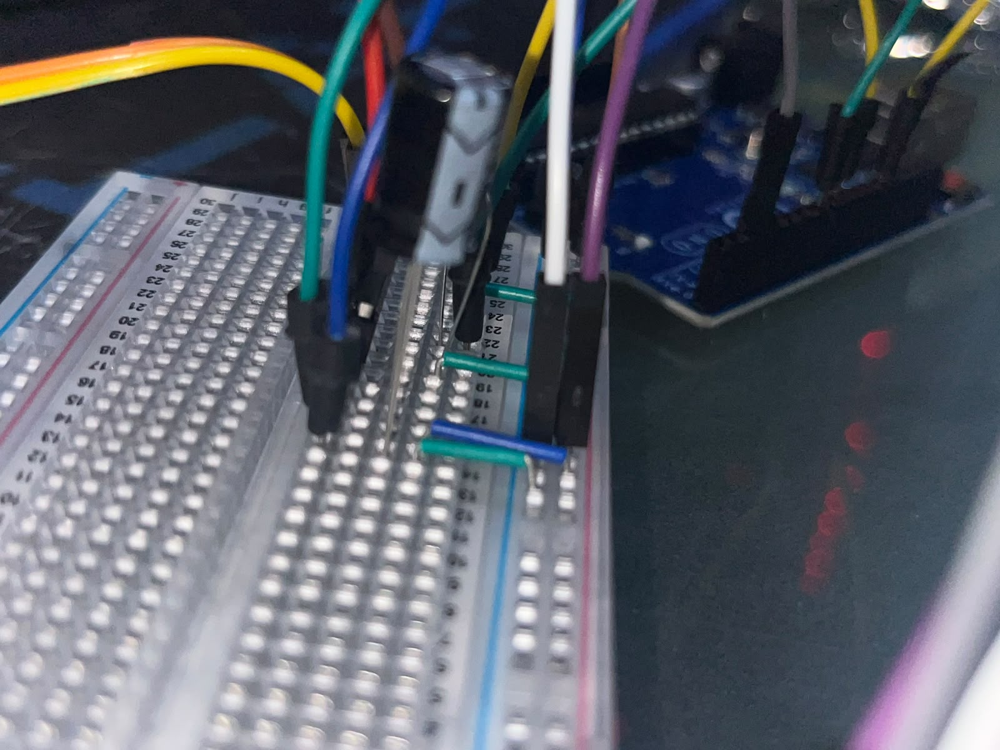
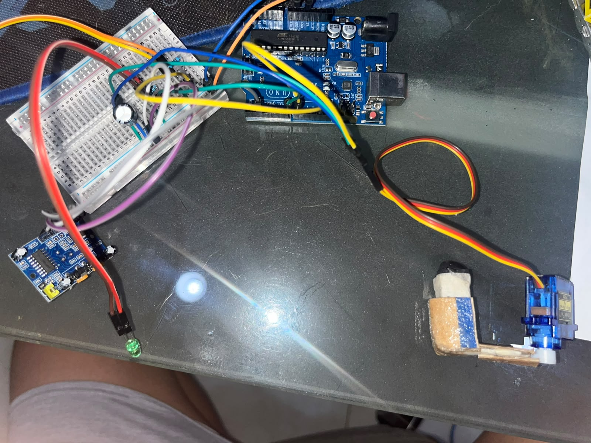
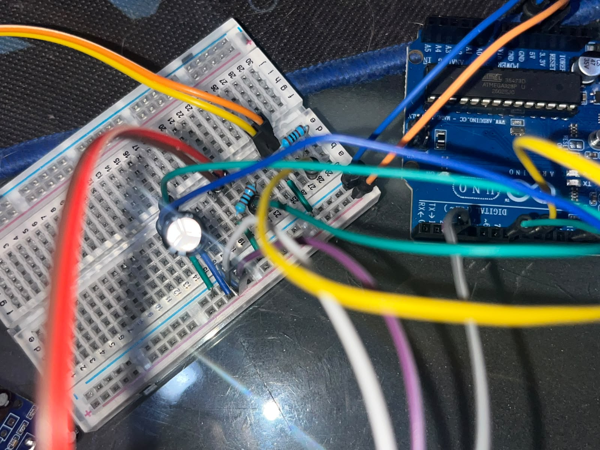

# Smart Motion-Activated Room Light System (Arduino)

## Overview
An ongoing hardware prototyping project integrating an Arduino Uno, an HC-SR501 PIR motion sensor, and an SG90 servo motor to explore automated room lighting control. Integrated a DIY mount onto the switch itself and a DIY extension for the servo arm.

## Visual Documentation & Prototyping
* **Circuit & Wiring:**
    
* **Circuit Wiring & Testing:**
  *(demo_video.mp4)*

## Simple Circuit Guide & Wiring
* **Arduino Uno to HC-SR501 PIR Sensor:**
  * **VCC (Pin 1 / Left):** Connected to Arduino `5V`
  * **OUT (Pin 2 / Center):** Connected to Arduino Digital Pin `2`
  * **GND (Pin 3 / Right):** Connected to Arduino `GND`

* **Arduino Uno to SG90 Servo Motor:**
  * **PWM Signal (Orange/Yellow wire):** Connected to Arduino Digital Pin `9`
  * **VCC (Red wire):** Connected to external 5V power source (Portable Power Bank)
  * **GND (Brown/Black wire):** Connected to Power Bank `GND` **and** shared with Arduino `GND` (common ground is required for signal stability).

* **Power Supply:**
  * Powered via a portable USB power bank connected to the Arduino/servo rail to eliminate voltage drops and current spikes during motor actuation.
    
## Issues Encountered
* **Power Stability:** Upgraded from standard batteries to a portable power bank to eliminate current dropouts and Arduino brownouts during servo actuation.
* **Mechanical Rigidity:** Engineered a rigid, glue-saturated cardboard U-channel extension to eliminate force-wasting flex between the servo arm and the switch paddle.
* **Software Optimization:** Implemented `detach()` state management in C++ to prevent continuous motor power draw and thermal stall at rest.
* **Current Status & Learnings:** While system testing revealed that the SG90 micro-servo's torque limit falls short against the heavy spring resistance of a standard household wall switch, this active design study provided crucial data on torque-to-load ratios and electromechanical constraints.

## Repository Contents
* `smart_light.ino`: The core C++ control script.
* `/docs`: System wiring notes and troubleshooting logs.
